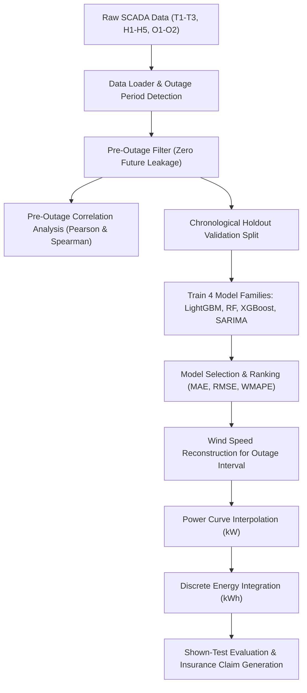

# BayWa r.e. Wind Farm Outage Analysis & Insurance Estimation Platform

A self-contained, enterprise-grade web application built for the **BayWa r.e. Wind Farm Outage Data Hackathon**.

The application reconstructs missing 10-minute target-turbine wind-speed observations during outage periods using spatial-temporal cross-park reference turbines, maps reconstructed wind speeds through turbine power curves to estimate potential energy loss, evaluates error diagnostics against shown-test ground truth, and generates interactive insurance claim documentation.

---

## 🌟 Key Features

* **Multi-Park Spatial Reconstruction**: Leverages high-correlation reference turbines from nearby wind parks (H1–H5, O1–O2) to estimate missing wind speeds on target turbines (T1–T3).
* **Deterministic Model Selection**: Trains and cross-evaluates **LightGBM**, **Random Forest**, **XGBoost**, and **ARIMA/SARIMA** strictly on pre-outage chronological holdout splits with zero future leakage.
* **Rigorous Energy Loss Modeling**: Converts reconstructed wind speeds to electrical power (kW) via turbine-specific power curves and performs discrete integration ($E = \sum P_i \times \frac{1}{6}\text{ h}$) to estimate potential lost generation (kWh).
* **Two Main Views**:
  * **Wind Farm Outage Analysis (`/`)**: Interactive dashboard with tabs for Overview, Data Upload (Excel & CSV), Outage Detection & Predictions, Explainability (Feature correlations), Energy Loss analysis, Validation & Shown-Test Metrics, and Technical Advanced Drawer.
  * **Insurance Report (`/insurance`)**: Executive summary and claim documentation ready for export (HTML & CSV).

---

## 🚀 Quick Start

### 1. Clone & Set Up Environment

```bash
git clone <YOUR_GITHUB_REPO_URL>
cd <REPO_FOLDER>

# Create and activate virtual environment (optional but recommended)
python -m venv venv
# On Windows:
.\venv\Scripts\activate
# On Linux / macOS:
source venv/bin/activate

# Install dependencies
pip install -r requirements.txt
```

### 2. Launch the Application

```bash
python windapp/app.py
```

Open your browser and navigate to:
**[http://localhost:5000](http://localhost:5000)**

---

## 🧪 Running Automated Tests

A comprehensive suite of 42 automated tests covers data integrity, missing-data detection, zero-leakage constraints, energy calculations, model rankings, and API endpoints:

```bash
pytest windapp/tests/ -v
```

---

## 🏗️ Architecture & Pipeline



---

## 📊 Dataset Structure

* **Target Turbines**: `T1`, `T2`, `T3`
* **Reference Turbines**: `H1`, `H2`, `H3`, `H4`, `H5`, `O1`, `O2`
* **Sampling Frequency**: 10-minute continuous time intervals
* **Hidden Outage Period**: 2026-09-01 00:00 to 2026-09-03 23:50 (432 missing intervals)
* **Evaluation Period**: 2026-09-04 00:00 to 2026-09-09 23:50 (Observed ground-truth)

---

## ⚠️ Domain Disclaimer

Expected normal energy represents potential generation loss under the baseline assumption of zero production during the outage period. It provides an engineering estimate to support claim review and is not an automatically certified financial settlement.
